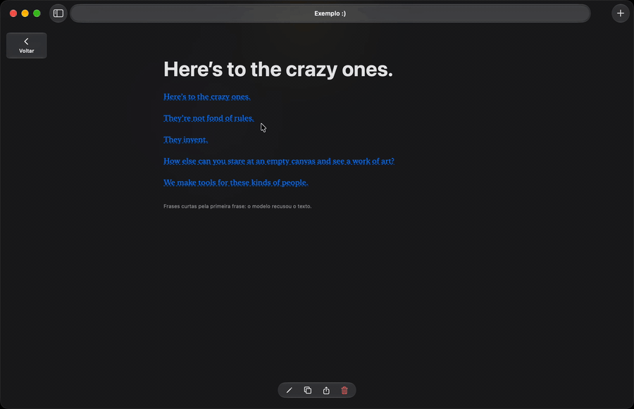
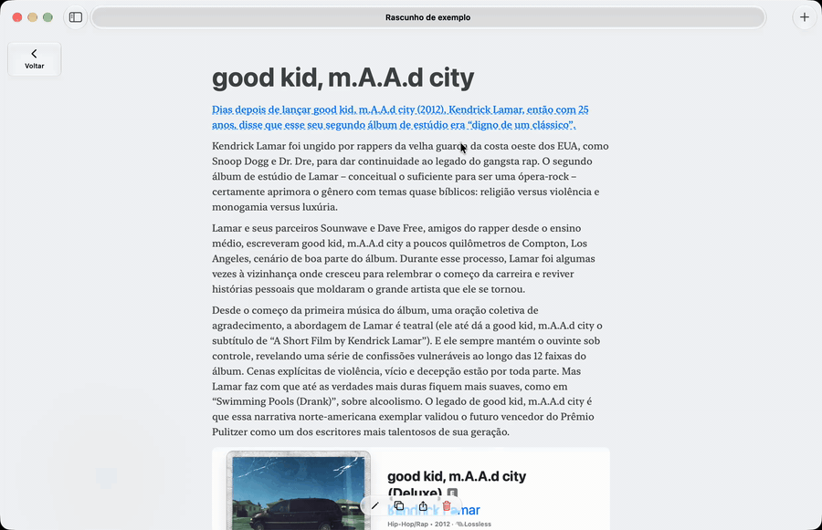

# StretchText

Texto que dobra e abre no lugar. Cada trecho tem uma forma curta e uma longa: toque na frase e o parágrafo inteiro aparece ali mesmo, com as palavras que você já tinha lido na mesma ordem.

<p align="center">
  
</p>

<p align="center">
  
</p>

Pacote Swift para **iOS 27** e **macOS 27**. Tudo roda no aparelho: sem rede, compatível com o App Sandbox. As duas formas são sempre texto do próprio autor. Quando o modelo do aparelho entra (opcional), ele só escolhe qual frase já existente representa o parágrafo, e nunca escreve nada.

## Produtos

| Produto | Para quê |
| --- | --- |
| `StretchText` | Núcleo determinístico: segmenta, dobra, valida e guarda o estado de leitura. Só `Foundation`. |
| `StretchTextUI` | Views SwiftUI: `StretchTextView` e `StretchMarkdownView`. |
| `StretchTextGeneration` | Escolha da frase pelo modelo do aparelho (Foundation Models), com cache e falhas tipadas. |

## Como usar

Requer Xcode 27.2 ou mais novo (Swift 6.4).

**1.** Clone o repositório e adicione o pacote como dependência local:

```sh
git clone https://github.com/joaaosc/StretchText.git
```

```swift
.package(path: "../StretchText/StretchText"),
// ...
.target(name: "MeuApp", dependencies: [
    .product(name: "StretchText", package: "StretchText"),
    .product(name: "StretchTextUI", package: "StretchText"),
]),
```

**2.** Dobre um texto e mostre na tela:

```swift
import StretchText
import StretchTextUI
import SwiftUI

let texto = "O build falha às vezes. O motivo é um cache que usa só o package.json como chave."

struct Leitura: View {
    @State private var state = StretchState(
        document: StretchFolder.foldWithFirstSentence(TextSegmenter.segment(texto)).document
    )

    var body: some View {
        ScrollView {
            StretchTextView(state: $state).padding()
        }
    }
}
```

Para Markdown com títulos, listas e imagens, use `StretchMarkdownView`. Para escolher a frase com o modelo do aparelho, use `StretchTextGeneration`. Os dois, com exemplos completos, estão no [README do pacote](StretchText/README.md).

## App de exemplo

O projeto inclui o app `StretchTextDemo` (`StretchTextDemo/StretchTextDemo.xcodeproj`), para iPhone, iPad e Mac. Ele permite experimentar os gestos de expansão, a renderização de Markdown com imagens e a alternância entre a primeira frase e a seleção pelo modelo do aparelho.

## Testes

```sh
cd StretchText
swift test
```

## Documentação

- [Guia completo do pacote](StretchText/README.md)
- [Contrato: tipos, regras e gramática da marcação](docs/contrato.md)
- [Avaliação da escolha de frase](StretchText/Evaluation/README.md)

## Licença

[Apache License 2.0](LICENSE).
